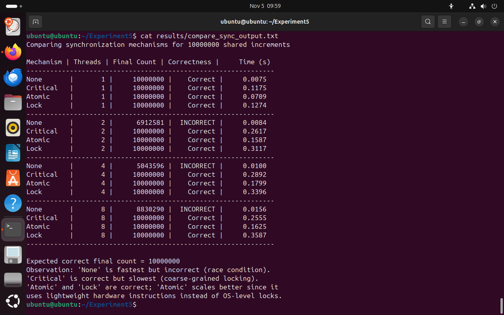

# Experiment 3: Synchronization Mechanisms

## Parallel and GPU Computing Laboratory

**Repository:** PGC – Experiment 3  
**Author:** Srushti  
**Programming Language:** C  
**Parallel Programming Model:** OpenMP and POSIX Threads

---

## 1. Introduction

Synchronization is a fundamental concept in parallel computing that ensures multiple threads access shared resources safely and consistently.

When multiple threads execute concurrently and modify shared data, race conditions may occur. These can produce incorrect results due to unpredictable execution order.

This experiment demonstrates and evaluates different synchronization mechanisms in C, including Critical Sections, Atomic Operations, Barriers, Semaphores, and Locks.

The experiment also compares the performance and correctness of synchronization techniques using a shared counter increment operation involving **10,000,000 increments**.

## 2. Objectives

- Understand race conditions in multithreaded programs.
- Implement critical section synchronization using OpenMP.
- Implement atomic operations for safe shared-variable updates.
- Understand barrier synchronization.
- Implement semaphore-based synchronization.
- Implement explicit lock-based synchronization.
- Compare synchronization mechanisms based on execution time and correctness.
- Analyze the impact of thread count on performance.

## 3. Technologies and Tools Used

| Component | Technology |
|---|---|
| Programming Language | C |
| Compiler | GCC |
| Parallel Programming | OpenMP |
| Thread Synchronization | POSIX Semaphores and OpenMP Locks |
| Operating System | Ubuntu Linux |
| Version Control | Git and GitHub |

## 4. Repository Structure

```text
PGC-Exp-3-Synchronization-Mechanisms/
│
├── SCREENSHOTS/
│   ├── 01_race_condition.png
│   ├── 02_critical_section.png
│   ├── 03_atomic_operation.png
│   ├── 04_Barrier.png
│   ├── 05_semaphore.png
│   ├── 06_lock.png
│   ├── 07_performance.png
│   └── 08_comparison.png
│
├── results/
│   └── compare_sync_output.txt
│
├── race.c
├── critical.c
├── atomic.c
├── barrier.c
├── semaphore.c
├── lock.c
├── performance.c
├── compare_sync.c
├── .gitignore
└── README.md
```

## 5. Synchronization Mechanisms Implemented

### 5.1 Race Condition

A race condition occurs when multiple threads access and modify shared data concurrently without proper synchronization.

**Observation:** The final counter may be less than the expected value because some increments are lost.

Source file: `race.c`

### 5.2 Critical Section

An OpenMP critical section ensures that only one thread at a time executes the protected section of code.

**Observation:** The shared counter is updated correctly, but thread execution may experience additional waiting time.

Source file: `critical.c`

### 5.3 Atomic Operation

An atomic operation ensures that a shared-variable update is performed as an indivisible operation.

**Observation:** Atomic synchronization maintains correctness while generally introducing less overhead than a critical section for simple updates.

Source file: `atomic.c`

### 5.4 Barrier Synchronization

A barrier synchronizes threads at a specific point in the program. Each thread waits until all participating threads reach the barrier.

**Observation:** Barrier synchronization ensures that threads proceed beyond the synchronization point together.

Source file: `barrier.c`

### 5.5 Semaphore

A semaphore controls access to shared resources using synchronization operations such as wait and post.

**Observation:** Semaphores coordinate access to shared resources and help prevent conflicting operations.

Source file: `semaphore.c`

### 5.6 OpenMP Locks

OpenMP locks provide explicit control over access to shared resources. A thread must acquire a lock before entering the protected section and release it afterward.

**Observation:** Locks ensure mutual exclusion, although acquiring and releasing locks introduces synchronization overhead.

Source file: `lock.c`

### 5.7 Performance Comparison

The performance comparison evaluates four approaches:

- No synchronization
- Critical section
- Atomic operation
- Explicit lock

Each mechanism is tested using 1, 2, 4, and 8 threads, with a total of 10,000,000 shared counter increments.

Source files: `performance.c` and `compare_sync.c`

## 6. Compilation and Execution

The programs can be compiled using GCC in an Ubuntu Linux environment.

### Compile the programs

**1. Race Condition**
```bash
gcc -fopenmp race.c -o race
```

**2. Critical Section**
```bash
gcc -fopenmp critical.c -o critical
```

**3. Atomic Operation**
```bash
gcc -fopenmp atomic.c -o atomic
```

**4. Barrier Synchronization**
```bash
gcc -fopenmp barrier.c -o barrier
```

**5. Semaphore**
```bash
gcc semaphore.c -o semaphore -pthread
```

**6. OpenMP Locks**
```bash
gcc -fopenmp lock.c -o lock
```

**7. Performance Comparison**
```bash
gcc -fopenmp performance.c -o performance
```

**8. Synchronization Comparison**
```bash
gcc compare_sync.c -fopenmp -o compare_sync
```

### Execute the programs

```bash
./race
./critical
./atomic
./barrier
./semaphore
./lock
./performance
./compare_sync
```

## 7. Performance Evaluation

### Experimental Configuration

| Parameter | Value |
|---|---|
| Total Shared Increments | 10,000,000 |
| Thread Configurations | 1, 2, 4, 8 |
| Synchronization Methods | None, Critical, Atomic, Lock |
| Expected Final Counter | 10,000,000 |

### Benchmark Results

The following measurements were obtained from the experimental execution.

| Mechanism | Threads | Final Count | Correctness | Time (seconds) |
|---|---:|---:|---|---:|
| None | 1 | 10,000,000 | Correct | 0.0075 |
| Critical | 1 | 10,000,000 | Correct | 0.1175 |
| Atomic | 1 | 10,000,000 | Correct | 0.0709 |
| Lock | 1 | 10,000,000 | Correct | 0.1274 |
| None | 2 | 6,912,581 | Incorrect | 0.0084 |
| Critical | 2 | 10,000,000 | Correct | 0.2617 |
| Atomic | 2 | 10,000,000 | Correct | 0.1587 |
| Lock | 2 | 10,000,000 | Correct | 0.3117 |
| None | 4 | 5,043,596 | Incorrect | 0.0100 |
| Critical | 4 | 10,000,000 | Correct | 0.2892 |
| Atomic | 4 | 10,000,000 | Correct | 0.1799 |
| Lock | 4 | 10,000,000 | Correct | 0.3396 |
| None | 8 | 8,830,290 | Incorrect | 0.0156 |
| Critical | 8 | 10,000,000 | Correct | 0.2555 |
| Atomic | 8 | 10,000,000 | Correct | 0.1625 |
| Lock | 8 | 10,000,000 | Correct | 0.3587 |

### Performance Analysis

**1. No Synchronization**

- Produced the expected result with a single thread.
- Produced incorrect results with 2, 4, and 8 threads.
- Demonstrates the effect of race conditions and lost updates.
- Has low execution time because no synchronization overhead is introduced.

**2. Critical Section**

- Produced the correct result for all tested thread configurations.
- Introduced comparatively high synchronization overhead.
- The critical section allows only one thread at a time to execute the protected operation.

**3. Atomic Operation**

- Produced the correct result for all tested thread configurations.
- Was faster than Critical and Lock in all measured configurations.
- Is suitable for simple shared-variable operations because atomic updates avoid the broader overhead of a general critical section.

**4. Explicit Lock**

- Produced the correct result for all tested thread configurations.
- Had the highest execution time among the synchronized approaches in these measurements.
- Requires explicit lock acquisition and release.

### Key Observations

- Synchronization is essential for maintaining data correctness in multithreaded programs.
- The unsynchronized implementation demonstrates lost updates when multiple threads modify a shared counter.
- Critical sections, atomic operations, and locks maintain the expected final count.
- Atomic operations performed best among the tested synchronization mechanisms.
- Increasing the number of threads does not automatically improve performance when threads frequently compete for the same shared variable.

## 8. Experimental Screenshots

### 8.1 Race Condition


### 8.2 Critical Section


### 8.3 Atomic Operation


### 8.4 Barrier Synchronization


### 8.5 Semaphore


### 8.6 OpenMP Locks


### 8.7 Performance Comparison


### 8.8 Synchronization Mechanism Comparison


## 9. Results and Conclusion

The experiment successfully demonstrated different synchronization mechanisms used in parallel programming.

The results showed that unsynchronized access to shared variables can lead to race conditions and incorrect results. Critical sections, atomic operations, and explicit locks ensured correct counter updates across all tested thread configurations.

Among the evaluated synchronization methods, atomic operations achieved the lowest execution time for the synchronized shared-counter workload.

The experiment highlights the importance of selecting an appropriate synchronization mechanism based on correctness requirements, computational workload, and synchronization overhead.

**Conclusion:** Synchronization mechanisms are essential for developing reliable and correct multithreaded applications. Atomic operations are particularly effective for simple shared-variable updates, while critical sections, barriers, semaphores, and locks provide synchronization capabilities for broader coordination requirements.

---

## 10. Author

**Srushti**  
Parallel and GPU Computing Laboratory

GitHub: [shettisrushti09-sketch](https://github.com/shettisrushti09-sketch)

---

*This repository contains the source code, experimental screenshots, benchmark results, and observations for the Synchronization Mechanisms experiment.*
